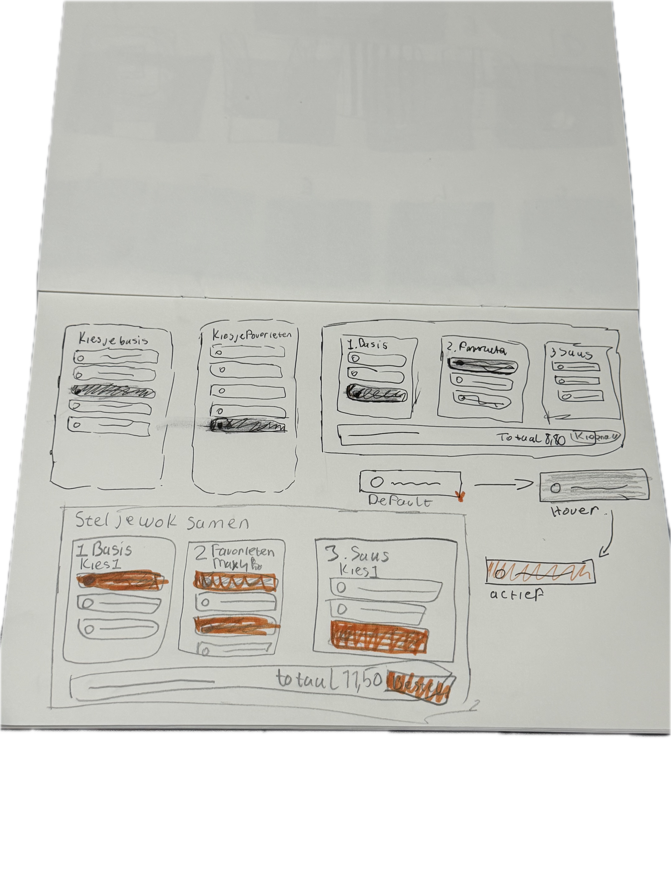
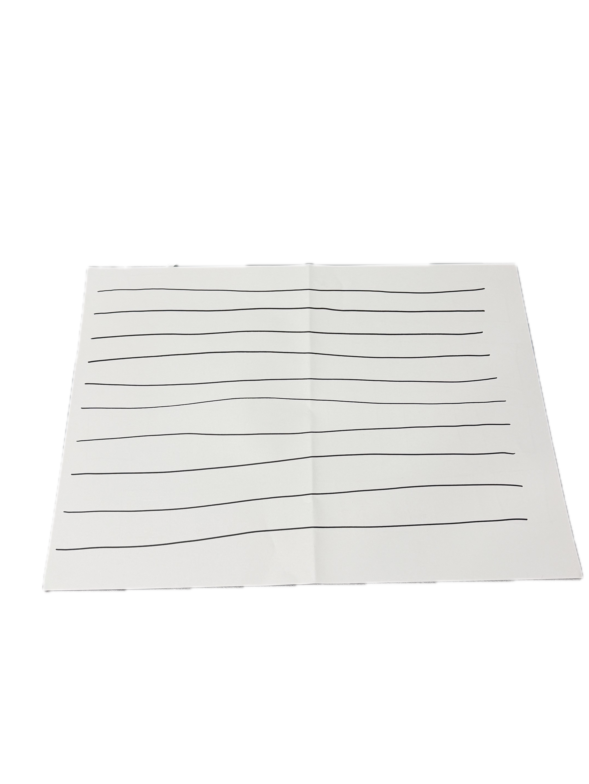
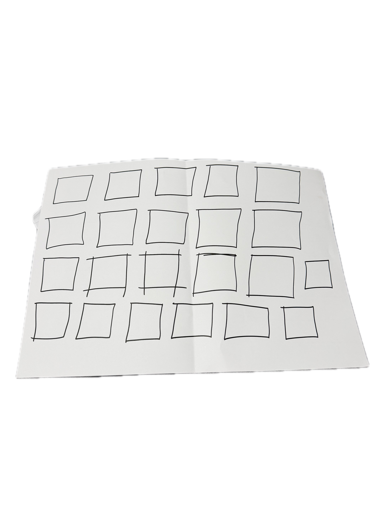
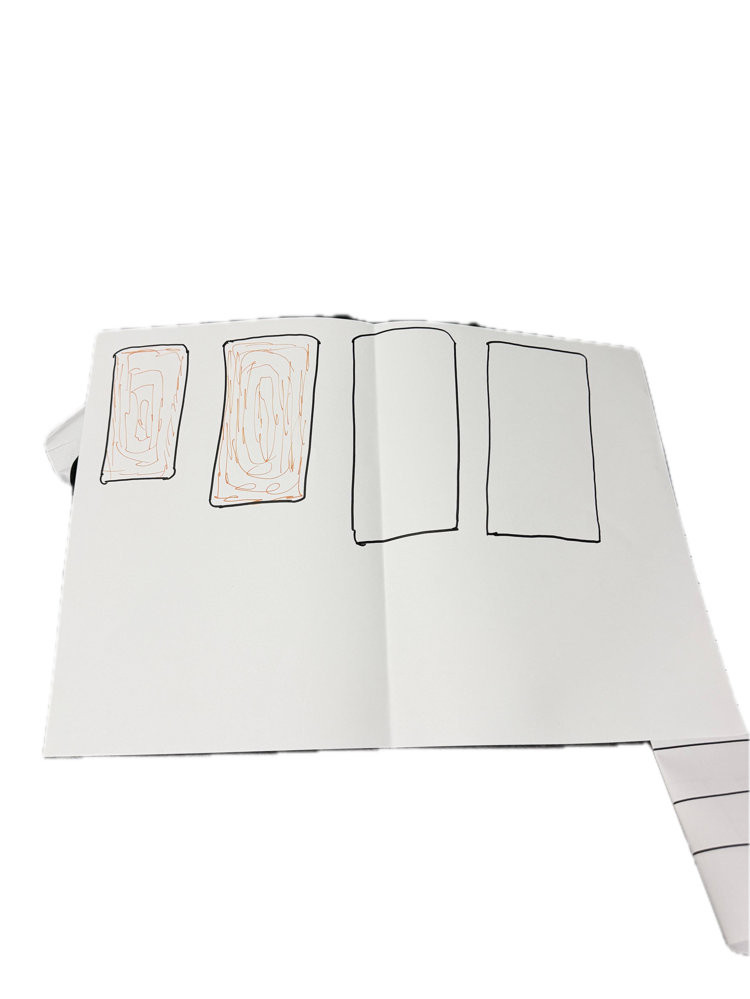
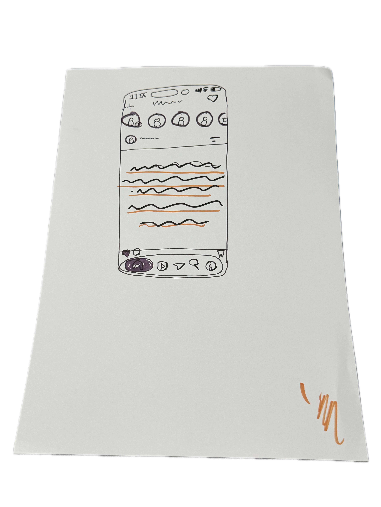

# Digital garden van Tolga

## Learning Log

### 11 nov - Interactie en Schetsen

Bij Interactie van Nicky heb ik het Wok to Walk menu geschetst als online formulier voor laptop en tablet. Eerst de drie kolommen los, daarna het hele scherm. Ik heb ook getekend hoe een rij eruitziet als default, bij hover en als hij actief is. In de laatste versie heb ik de gekozen opties oranje gemaakt en het totaal onderaan gezet.

Bij Schetsen van Charley heb ik de basisoefeningen gedaan. Ik heb rechte lijnen, vierkanten en een iPhone op ware grootte getekend. Twee iPhones heb ik ingekleurd met schaduw en kleur. Daarna heb ik een mi-fi schets gemaakt van Instagram, een app die ik vaak gebruik.

### 9 nov Kickoff

Ik heb GitHub gekozen als source hosting platform. Daar staat mijn code en van daaruit gaat mijn site online. Ik heb de model repository geforkt en GitHub Pages aangezet.

Mijn domein is tolgakece.nl. Ik heb mijn eigen naam gekozen omdat dit mijn portfolio wordt en ik het wil houden. Ik heb het gekocht bij TransIP. Daar heb ik de standaard instellingen uitgezet en 4 A-records en een CNAME voor www gemaakt die naar GitHub wijzen. Op GitHub heb ik bij Pages mijn domein ingevuld. Toen de DNS check groen was heb ik HTTPS aangezet.

Op mijn MacBook heb ik VSCodium en Prettier geïnstalleerd en mijn repository gecloned. Ik pas dingen aan in VSCodium en sla op. Daarna commit ik en klik ik op Sync Changes. Dan staat het op GitHub en zet GitHub Pages het online. Mijn eerste aanpassing was de titel van de pagina.
