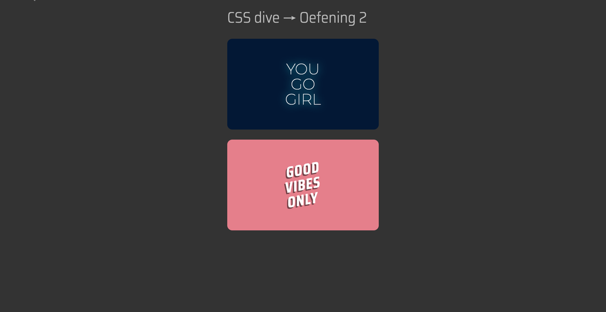
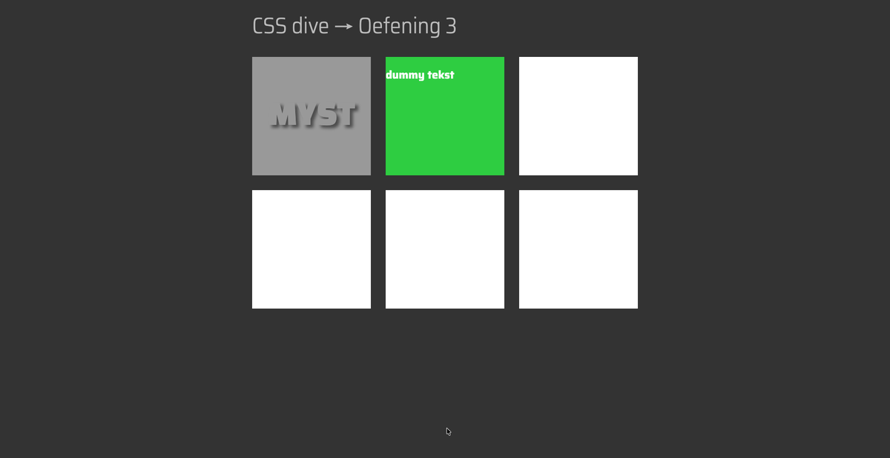
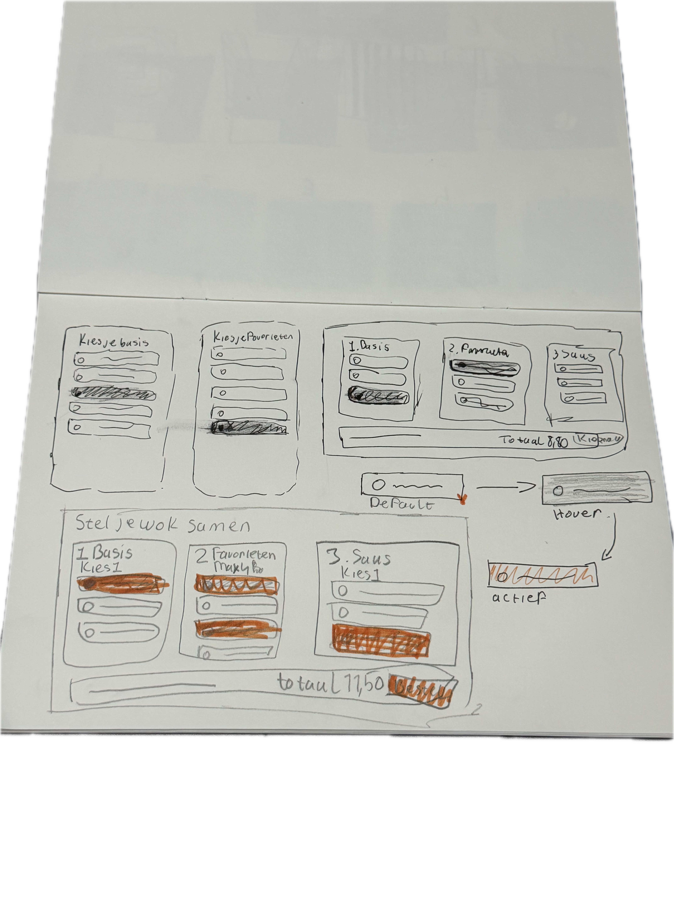
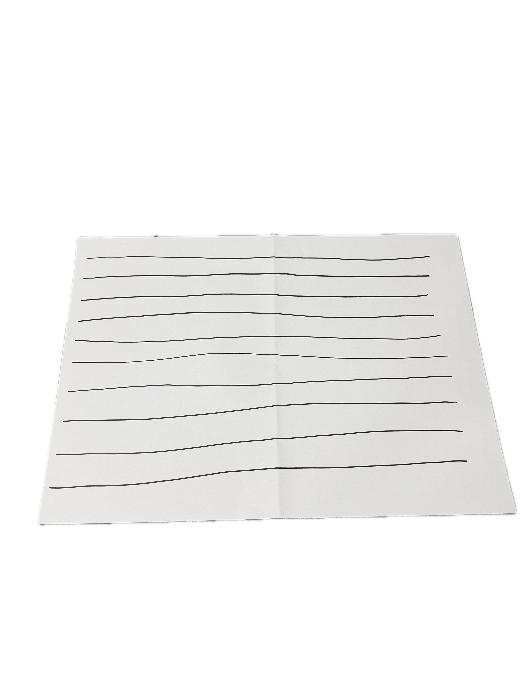

# Digital garden van Tolga

## Learning Log

### 13 nov - Praktische CSS en CSS fonts

Deze twee deep dives heb ik in het weekend gemaakt.

Bij Praktische CSS van Vasilis heb ik in CodePen een lelijke HTML pagina gemaakt over het wachten op GTA 6. Daarna heb ik hem met CSS leesbaar gemaakt. Eerst deed mijn CSS niks. Mijn index.html had geen link naar style.css. Toen ik die regel bovenaan zette werkte het wel.

Voor de witruimte en de grootte van de koppen heb ik custom properties gebruikt. Ik heb --factor getest met 1.2, 1.3 en hoger. Dan werden de koppen te groot naast de gewone tekst en klopte de verhouding niet. Ik heb 1.1 gekozen. Daarna heb ik een link met hover en focus en een formulier toegevoegd. De rand om het formulier heb ik weggehaald omdat het er zo beter uitziet.

Bij CSS fonts van Sanne heb ik lettertypen toegevoegd met @font-face. Ik heb steeds mijn versie naast het voorbeeld van Sanne gelegd en getallen aangepast. Bij oefening 1 was de eerste letter met 3em veel te groot, met 1.5em leek hij. Bij oefening 2 was de gloed met .5em te verspreid, met .2em zit hij strak om de letters. De letters en regels stonden te dicht op elkaar, dus ik heb line-height 1.1 en letter-spacing .1em gebruikt. De schaduw heb ik steeds van .2 naar .5 veranderd om te vergelijken. Ik vond .2 er beter uitzien.

Bij oefening 3 heb ik het blokje Myst nagemaakt. Met 3em waren de letters kleiner dan bij Sanne, 4em klopte beter. Bij oefening 4 heb ik een transitie toegevoegd. Als je over het blokje gaat schuift de schaduw verder weg en draait de tekst 180 graden. Die draai heb ik zelf toegevoegd omdat het blokje er speelser door wordt.

Bronnen zijn de deep dives van Vasilis en Sanne.

### 11 nov - Interactie en Schetsen

Bij Interactie van Nicky heb ik het Wok to Walk menu geschetst als online formulier voor laptop en tablet. Eerst de drie kolommen los, daarna het hele scherm. Ik heb ook getekend hoe een rij eruitziet als default, bij hover en als hij actief is. In de laatste versie heb ik de gekozen opties oranje gemaakt en het totaal onderaan gezet.

Bij Schetsen van Charley heb ik de basisoefeningen gedaan. Ik heb rechte lijnen, vierkanten en een iPhone op ware grootte getekend. Twee iPhones heb ik ingekleurd met schaduw en kleur. Daarna heb ik een mi-fi schets gemaakt van Instagram, een app die ik vaak gebruik.

### 9 nov Kickoff

Ik heb GitHub gekozen als source hosting platform. Daar staat mijn code en van daaruit gaat mijn site online. Ik heb de model repository geforkt en GitHub Pages aangezet.

Mijn domein is tolgakece.nl. Ik heb mijn eigen naam gekozen omdat dit mijn portfolio wordt en ik het wil houden. Ik heb het gekocht bij TransIP. Daar heb ik de standaard instellingen uitgezet en 4 A-records en een CNAME voor www gemaakt die naar GitHub wijzen. Op GitHub heb ik bij Pages mijn domein ingevuld. Toen de DNS check groen was heb ik HTTPS aangezet.

Op mijn MacBook heb ik VSCodium en Prettier geïnstalleerd en mijn repository gecloned. Ik pas dingen aan in VSCodium en sla op. Daarna commit ik en klik ik op Sync Changes. Dan staat het op GitHub en zet GitHub Pages het online. Mijn eerste aanpassing was de titel van de pagina.
