# Digital garden van Tolga

## Eigen verkenning

### Wat ik wil maken

Ik maak een portfolio als digital garden, over mij als ontwerper. Ik wil daar mijn werk van school laten zien. Ik zou het na dit blok graag blijven bijhouden.

### Wat ik zag en nog niet kan

Bruno Simon heeft van zijn portfolio een game gemaakt waarin je met een auto langs zijn projecten rijdt. Dat kan ik nog niet, maar het spreekt me aan omdat ik veel game. Bij Maggie Appleton heeft elke tekst een groeifase. Dat vind ik een mooi idee voor een digital garden, omdat je dan ziet wat nog groeit.

### Webby dingen die ik zag

Bij Ste Grainer en Mike Mai kan je zelf licht, donker of automatisch kiezen. Dat heb ik vandaag in het practicum geoefend, dus dat is een idee voor mijn eigen garden. Lynn Fisher bewaart oude versies van haar site en Basher heeft een grote eerste letter. Dat vond ik ook interessant.

### Mijn eigen content

Ik denk aan schetsen, prototypes en eindresultaten van mijn projecten, met wat ik ervan geleerd heb. Het doel is dat je mijn groei als ontwerper kan zien.

### Content van anderen

Mijn garden gaat over mijn eigen werk, dus het meeste is van mij. Laat ik iets van een ander zien, zoals een screenshot van een site, dan hoort daar een bron bij en mijn eigen tekst over wat ik eruit haal.

### Hoe je het kan ervaren

Dat weet ik nog niet precies. Zelf licht of donker kiezen is een idee, omdat ik dat al geoefend heb. In mijn 50 afbeeldingen zag ik veel donkere achtergronden met roze, paars en groen. Dat kan een begin zijn voor mijn kleuren.

## Learning Log

### 18 nov - Werkgroep 2

Vandaag heb ik mijn HTML presentatie in een tweetal gepresenteerd. Daarna heeft mijn medestudent mij de vragen van DLO gesteld.

Wat is voor jou de essentie van je onderwerp en content? Mijn digital garden is een plek waar ik mijn werk als ontwerper verzamel en waar je kan zien hoe ik groei. Nu is het vooral schoolwerk. Later kan ik het laten zien aan een stagebedrijf of werkgever.

Heeft de ander een aanvulling op je onderwerp? Ik vroeg of het een goed onderwerp is. Mijn medestudent vond het goed en nuttig, omdat ik dan al mijn werk op een rijtje heb. Welk karakter of gevoel past bij je onderwerp? Het karakter ben ik zelf, een student met al wat ervaring die nog groeit. Het gevoel moet inspirerend zijn, zodat mensen zin krijgen om zelf iets te maken.

Welke woorden uit de kwaliteitenlijst passen bij je onderwerp? Expressief en leuk of verrassend.

Welke inspiratie haal je uit je afbeeldingen? Groeiend en speels. Groeiend zie ik in mijn eigen schetsen die later een prototype worden. Speels zie ik in sites als Bruno Simon en tamaNOTchi, die voelen als een game.

Wat wil je een ander vertellen over je onderwerp? Ik wil laten zien hoe ik werk, van eerste schets tot eindresultaat. Zo zie je wat ik kan en raak je misschien zelf geïnspireerd.

Ik wil mijn digital garden laten gaan over mijn werk als ontwerper en wil dat laten zien door schetsen, prototypes en eindresultaten van mijn projecten aan content te tonen. Ik begin met een stukje eigen content over mijn eerste project uit jaar 1, de app en het 3D stadion. Dan begint mijn garden bij het begin. Als het begin is gemaakt kan ik mijn garden verder uitbreiden door elk blok een nieuw project toe te voegen.

### 17 nov - Practicum Light & Dark

Bij oefening 3 heb ik van een foto met hardlopers een responsive afbeelding gemaakt met het picture element. Er zijn vier versies van de foto. Groot is de hele foto en klein is een uitsnede van de schoen. De donkere versies zijn dezelfde foto's maar donkerder. Die vier versies heb ik gemaakt met een fotobewerking. De img onderaan is licht en klein. Daarboven staan met source donker en klein, licht en groot en donker en groot. Met een media query met and kies je de foto voor een breed scherm in donker.

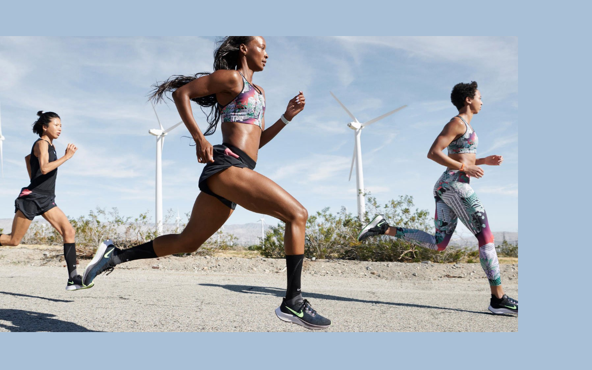
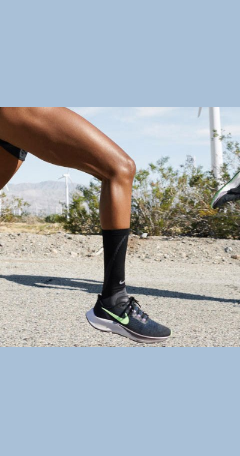

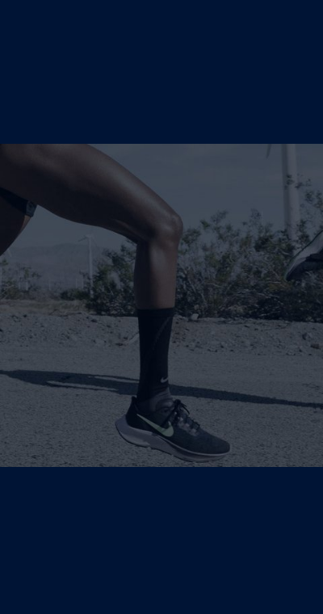

Bij oefening 1 en 2 van Vasilis heb ik met custom properties een licht en donker thema gemaakt in CodePen. Eerst heb ik de pen geforkt. Ik keek de code op DLO, Ik heb die gelezen, in mijn fork gezet en na elk stuk getest.

Bij oefening 1 heb ik in de html selector custom properties gemaakt voor de achtergrond, de tekst, de rand en de kop. In body en h1 gebruik ik ze met var(). Om te testen heb ik de rand naar oranje veranderd. De rand veranderde meteen mee terwijl ik alleen de custom property bovenaan had aangepast.

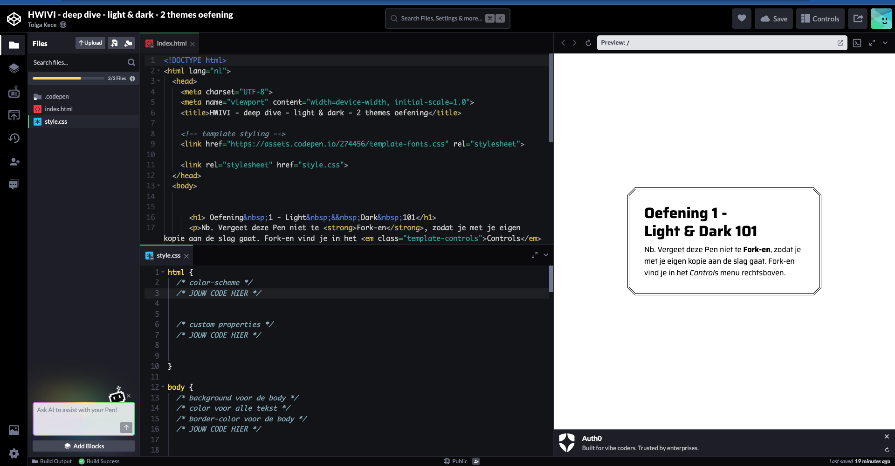

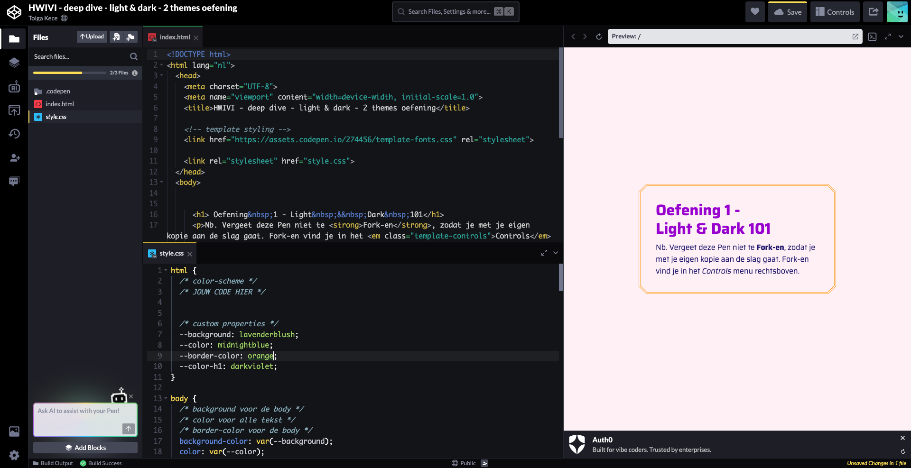

Daarna heb ik color-scheme light dark aangezet en elke custom property twee kleuren gegeven met light-dark(). De eerste kleur is voor licht en de tweede voor donker. Ik heb het getest door mijn Mac in Systeeminstellingen van donker naar licht te zetten.

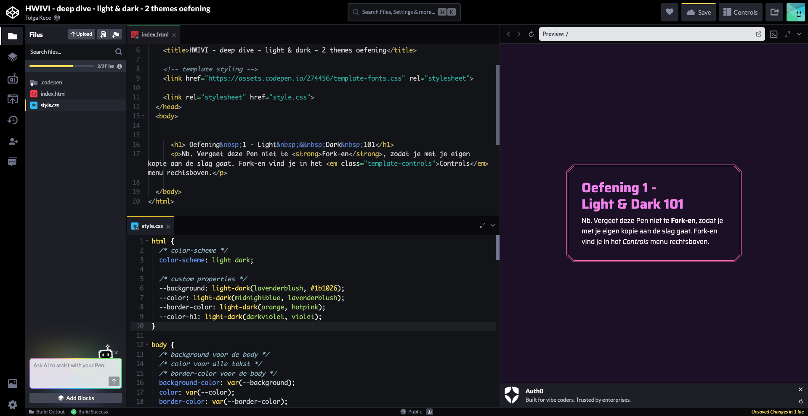

Oefening 2 was een kattenwinkel die helemaal grijs begon. Die heb ik in drie stukken gedaan. Eerst de achtergrond, de tekst en de header. Daarna de keuze tussen auto, licht en donker in de header. Als laatste de kaartjes en de knoppen met een andere kleur bij hover en active. Omdat ik light-dark() gebruik werken de keuzeknoppen in de header meteen.

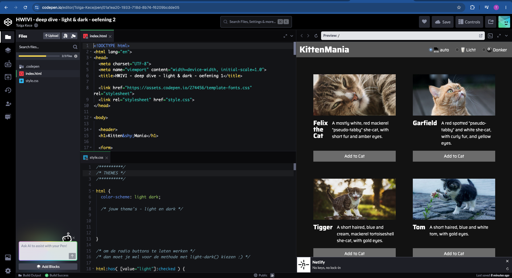

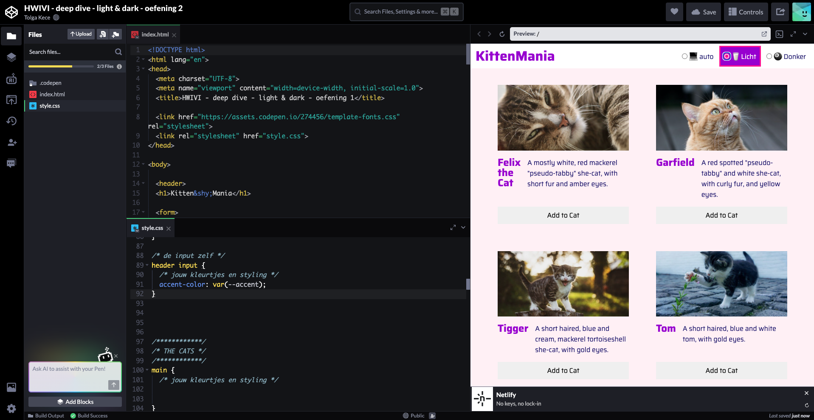

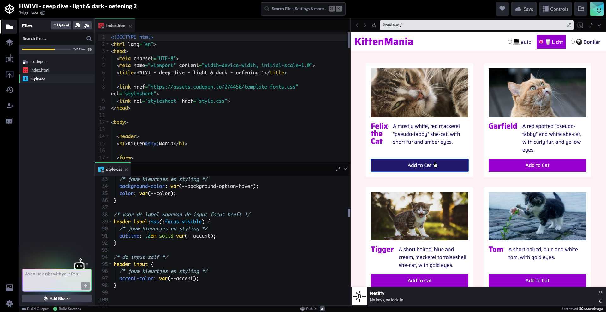

Bronnen zijn het practicum Light & Dark van Vasilis op DLO en de CodePens van de docenten.

### 17 nov - Presentatie digital garden

Mijn onderwerp is ik als ontwerper. Ik wil een portfolio bouwen waarin je kan zien hoe ik groei als ontwerper.

Voor de 50 afbeeldingen heb ik mijn oude werk van DLO gebruikt. Daaruit komen 29 afbeeldingen van jaar 1 blok 1, 3 en 4 en jaar 2 blok 1. De andere 21 zijn screenshots van sites. 15 komen uit de lijst met voorbeelden op DLO en 6 heb ik erbij gezocht, zoals Bruno Simon en de site van GTA 6. Ik heb de bestanden gedownload, de screenshots gemaakt en er 8 collages van gemaakt, omdat je maar 15 slides mag hebben.

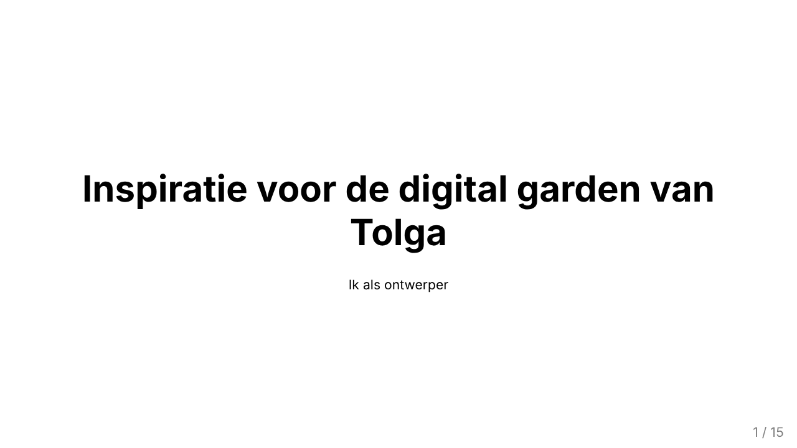
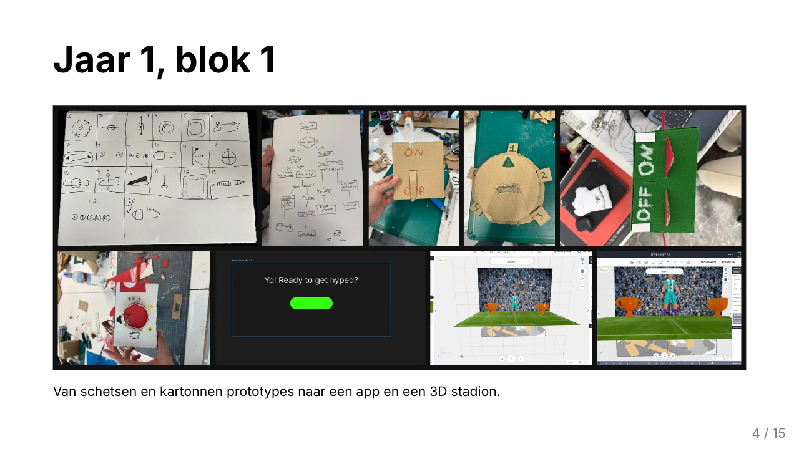
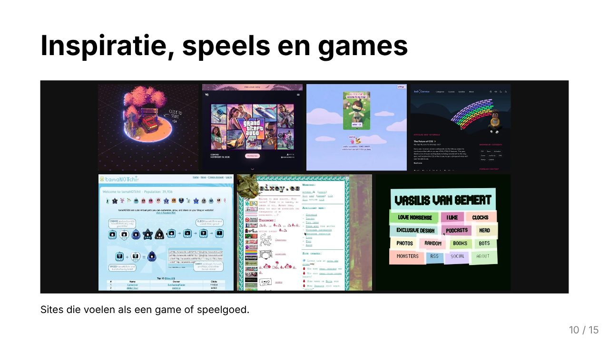

Remark kende ik nog niet. De slides zijn gewoon Markdown, net als mijn README. Een nieuwe slide begin je met `---` en een titel met `#`. Een afbeelding zet je erin met ``. De presentatie heb ik in vier stappen gebouwd en na elke stap getest en gecommit.

Eerst vielen de collages buiten de slide. Met `img { max-width: 100%; }` uit de reset van praktische CSS passen ze wel.

Bronnen zijn de opdracht op DLO, de Remark template van de docenten en de 21 sites die in de presentatie staan.

### 16 nov - Sprintplanning en verkenning onderwerp

Vandaag begon sprint 1. De opdracht is de eerste versie van mijn digital garden ontwerpen, bouwen en online zetten. Mijn planning voor het huiswerk heb ik in mijn notities gezet. Ik heb mijn fork gesynct met de repository van de docenten. Daardoor kwam de map oefeningen met de presentatie in mijn repository.

In mijn expertgroep heb ik Digital Garden Terms of Service van Shawn Wang gelezen. Dat gaat over wat je als lezer kan verwachten van een digital garden, bijvoorbeeld dat teksten nog niet af zijn en later nog veranderen.

Een gewone website is vaak af als hij online staat en een blog zet alles op datum. Een digital garden groeit. Je zet er ook dingen op die nog niet af zijn en je werkt ze later bij. Het is meer een verzameling die met links aan elkaar zit dan een tijdlijn.

Op DLO staat wanneer iets webby is. Fluïde, interactief, toegankelijk, volwassen, expressief en leuk of verrassend. Voor mij is een site webby als hij iets doet wat alleen op het web kan, zoals meebewegen met je scherm of zelf licht en donker kiezen. De sites die mij het meeste inspireren zijn Bruno Simon, Maggie Appleton en Mike Mai.

Mijn eerste idee is een portfolio over mij als ontwerper, waarin je mijn groei kan zien. Dat kan nog veranderen.

Bronnen zijn de opdrachten op DLO en het artikel van Shawn Wang.

### 13 nov - Praktische CSS en CSS fonts

Deze twee deep dives heb ik in het weekend gemaakt.

Bij Praktische CSS van Vasilis heb ik in CodePen een lelijke HTML pagina gemaakt over het wachten op GTA 6. Daarna heb ik hem met CSS leesbaar gemaakt. Eerst deed mijn CSS niks. Mijn index.html had geen link naar style.css. Toen ik die regel bovenaan zette werkte het wel.

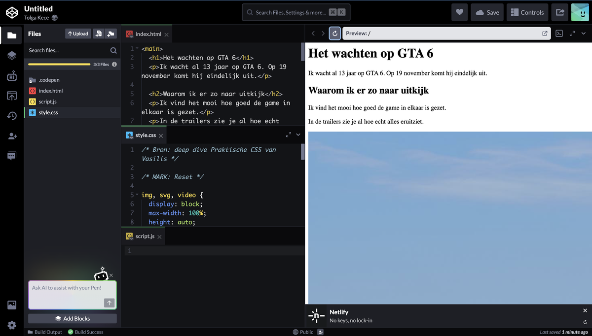

Voor de witruimte en de grootte van de koppen heb ik custom properties gebruikt. Ik heb --factor getest met 1.2, 1.3 en hoger. Dan werden de koppen te groot naast de gewone tekst en klopte de verhouding niet. Ik heb 1.1 gekozen. Daarna heb ik een link met hover en focus en een formulier toegevoegd. De rand om het formulier heb ik weggehaald omdat het er zo beter uitziet.

Bij CSS fonts van Sanne heb ik lettertypen toegevoegd met @font-face. Ik heb steeds mijn versie naast het voorbeeld van Sanne gelegd en getallen aangepast. Bij oefening 1 was de eerste letter met 3em veel te groot, met 1.5em leek hij. Bij oefening 2 was de gloed met .5em te verspreid, met .2em zit hij strak om de letters. De letters en regels stonden te dicht op elkaar, dus ik heb line-height 1.1 en letter-spacing .1em gebruikt. De schaduw heb ik steeds van .2 naar .5 veranderd om te vergelijken. Ik vond .2 er beter uitzien.

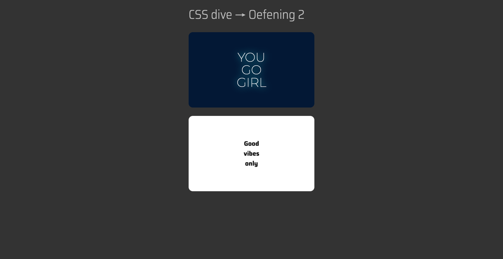

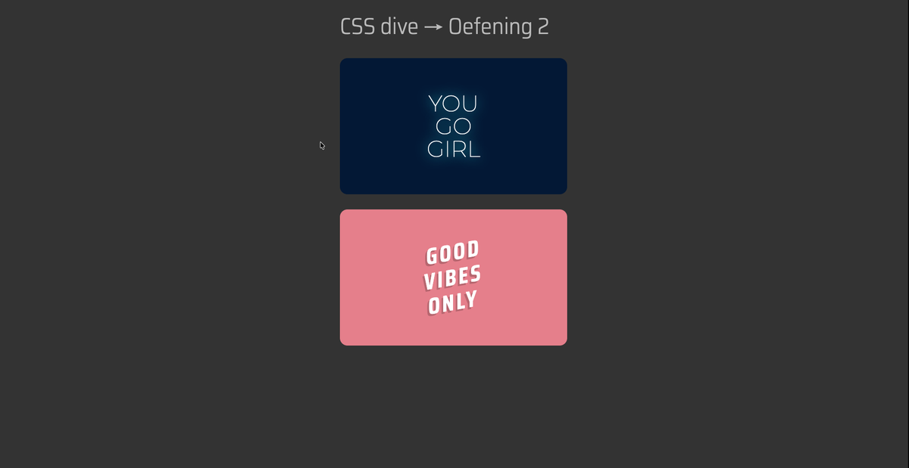

Bij oefening 3 heb ik het blokje Myst nagemaakt. Met 3em waren de letters kleiner dan bij Sanne, 4em klopte beter. Bij oefening 4 heb ik een transitie toegevoegd. Als je over het blokje gaat schuift de schaduw verder weg en draait de tekst 180 graden. Die draai heb ik zelf toegevoegd omdat het blokje er speelser door wordt.

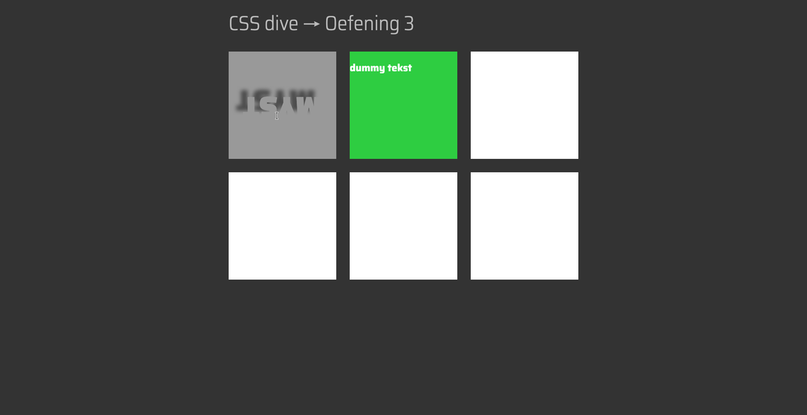

Bronnen zijn de deep dives van Vasilis en Sanne.

### 11 nov - Interactie en Schetsen

Bij Interactie van Nicky heb ik het Wok to Walk menu geschetst als online formulier voor laptop en tablet. Eerst de drie kolommen los, daarna het hele scherm. Ik heb ook getekend hoe een rij eruitziet als default, bij hover en als hij actief is. In de laatste versie heb ik de gekozen opties oranje gemaakt en het totaal onderaan gezet.

Bij Schetsen van Charley heb ik de basisoefeningen gedaan. Ik heb rechte lijnen, vierkanten en een iPhone op ware grootte getekend. Twee iPhones heb ik ingekleurd met schaduw en kleur. Daarna heb ik een mi-fi schets gemaakt van Instagram, een app die ik vaak gebruik.

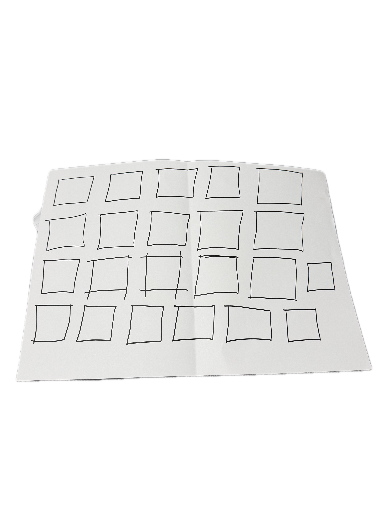

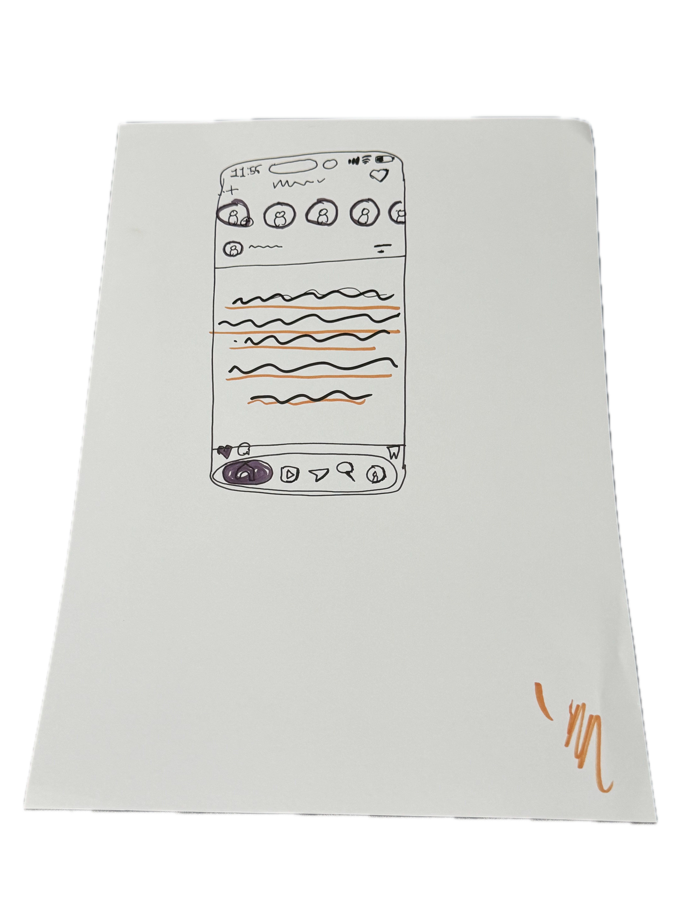

### 9 nov Kickoff

Ik heb GitHub gekozen als source hosting platform. Daar staat mijn code en van daaruit gaat mijn site online. Ik heb de model repository geforkt en GitHub Pages aangezet.

Mijn domein is tolgakece.nl. Ik heb mijn eigen naam gekozen omdat dit mijn portfolio wordt en ik het wil houden. Ik heb het gekocht bij TransIP. Daar heb ik de standaard instellingen uitgezet en 4 A-records en een CNAME voor www gemaakt die naar GitHub wijzen. Op GitHub heb ik bij Pages mijn domein ingevuld. Toen de DNS check groen was heb ik HTTPS aangezet.

Op mijn MacBook heb ik VSCodium en Prettier geïnstalleerd en mijn repository gecloned. Ik pas dingen aan in VSCodium en sla op. Daarna commit ik en klik ik op Sync Changes. Dan staat het op GitHub en zet GitHub Pages het online. Mijn eerste aanpassing was de titel van de pagina.
